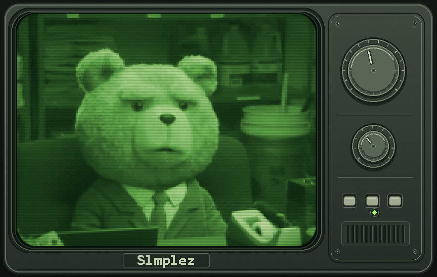

  

I’m [Dio](https://github.com/Slmplez), and I build tools for coding agents and multi-agent collaboration.

## Selected projects

- [Agent Room](https://github.com/Slmplez/AgentRoom) — A desktop chat app where coding agents from different engines can work together.
- [Pi ASCET UI Extension](https://github.com/Slmplez/Pi-ascet-ui-extension) — A Pi extension with an ASCET-themed startup screen, recent sessions, and terminal activity feedback.
